<p align="center">
  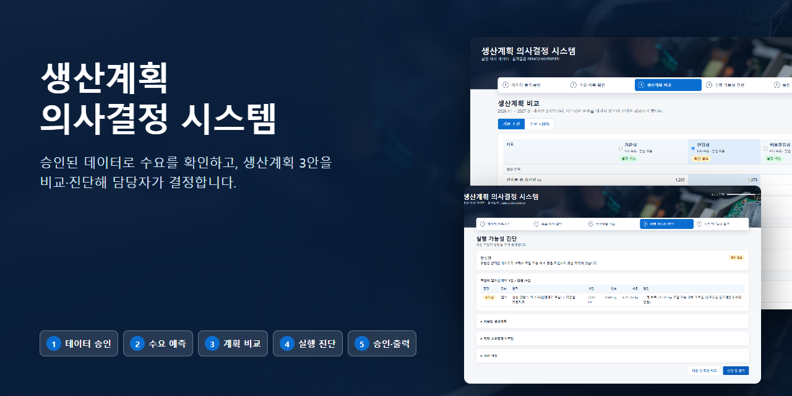
</p>

<p align="center">
  
  
  
  
  
</p>

# 생산계획 의사결정 시스템 (Production Planning Decision Support System)

제조 중소·중견 기업의 수요 예측, 생산계획 비교, 실행 가능성 진단, 최종 승인까지의 전체 의사결정 프로세스를 지원하는 AI 기반 웹 애플리케이션입니다.

## 한눈에 보기

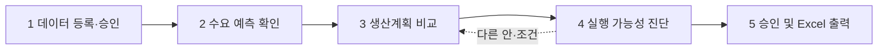

| 1. 데이터 등록·승인 | 2. 수요 예측 | 3. 계획 비교 |
|:---:|:---:|:---:|
| 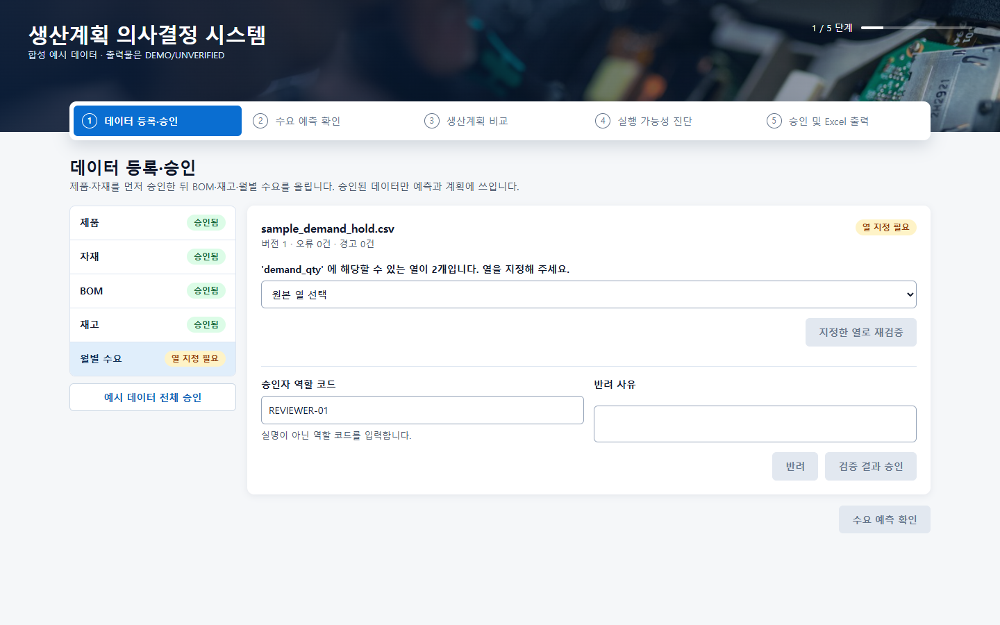 | 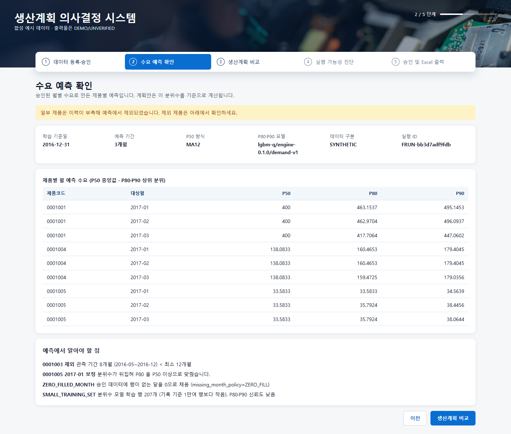 | 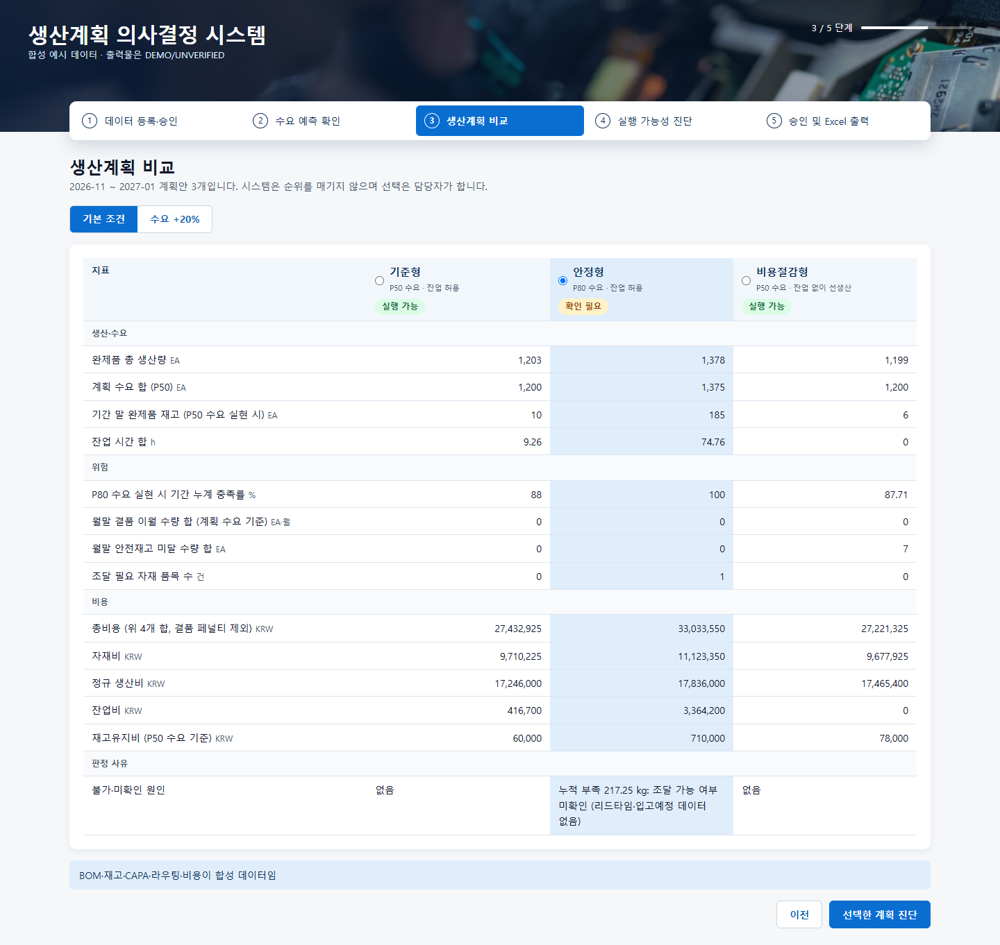 |
| **4. 실행 가능성 진단** | **5. 승인·출력** | |
| 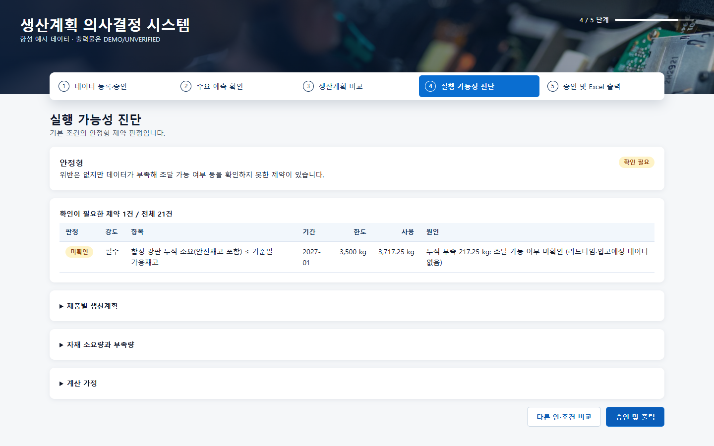 | 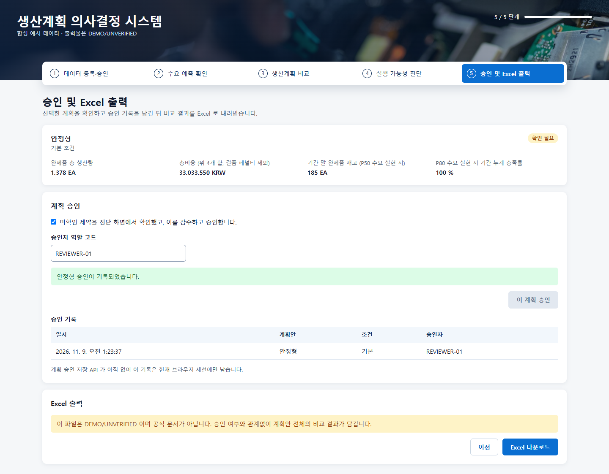 | |

---

## 핵심 흐름

데이터 등록·승인 → 수요 예측 실행·저장·이력 조회는 실제 API입니다. 이후 계획 비교·진단·계획 승인은 독립 예시이며 실제 예측과 연결되지 않았습니다.

### 1. 데이터 등록·승인


- 제품·자재를 먼저 승인해야 BOM·재고·월별 수요를 올릴 수 있습니다.
- 배치 상태(`MAPPING_HOLD`, `HAS_ERRORS`, `READY_FOR_APPROVAL`, `APPROVED`, `REJECTED`)별로 열 지정·재검증, 오류 확인, 승인·반려를 처리합니다.
- 승인자는 실명이 아닌 역할 코드(`REVIEWER-01`)로 입력합니다.
- CSV/XLSX 등록은 실제 `POST /batches`를 호출합니다. 열 지정·재검증·승인·반려는 서버 응답으로만 상태를 갱신합니다.
- 새로고침 시 배치 목록·상세를 DB에서 다시 조회합니다. 브라우저에는 선택한 배치 ID만 저장합니다.
- 409 충돌은 최신 결과를 다시 검토하고 재요청합니다. 연결 실패 시 예시 승인으로 전환하지 않습니다.

### 2. 수요 예측 확인


- 제품·월별 P50·P80·P90, 실행 정보, 제외 제품, 분위수 보정, 경고를 표시합니다.
- 기준일·예측 기간·P50 방식·최소 이력·시드를 입력해 승인 수요로 실제 실행합니다. 이력·상세와 입력 지문·출처 버전을 조회하고 새로고침 후 서버 결과를 복원합니다.
- 부분 성공·데이터 부족·입력 오류/run=null·모델 실패를 구분합니다. 서버 오류 시 예시 결과로 전환하지 않습니다.

### 3. 생산계획 비교


- 기준형·안정형·비용절감형의 KPI와 실행 가능성(`FEASIBLE`, `UNVERIFIED`, `INFEASIBLE`)을 나란히 비교합니다.
- 기본 조건과 수요 +20% 조건을 전환합니다. 시스템은 순위를 매기지 않습니다.

### 4. 실행 가능성 진단


- 선택한 계획의 위반·미확인 제약과 원인, 제품별 생산계획, 자재 소요·부족량, 계산 가정을 보여줍니다.

### 5. 승인 및 Excel 출력


- 실행 불가 계획은 승인할 수 없고, 미확인 계획은 확인 체크 후 승인합니다.
- Excel은 실제 `POST /exports/plans/xlsx`를 호출하며 DEMO/UNVERIFIED 출력입니다.

### API 연결 현황

| 영역 | 현재 동작 |
|---|---|
| `/batches*`, 마스터·수요 조회 | 실제 PostgreSQL 저장·재검증·승인·반려·조회. `PERSISTENCE=postgres` 필요 |
| `POST /exports/plans/xlsx` | 예시 계획 JSON으로 실제 서버 호출. 공식 승인 문서 아님 |
| `/dev/forecasts` | 백엔드의 합성 JSON 전용 예측 API. 현재 예측 화면은 아직 이 API를 호출하지 않음 |
| `POST/GET /forecasts`, `GET /forecasts/{execution_id}` | 승인 월별 수요로 실제 예측·저장·이력·상세 조회. Alembic 0005 필요 |
| 계획 비교·진단 화면, 계획 승인 저장 | 예시 응답과 메모리 기록. 실제 예측 결과와 미연결 |

---

## 시스템 아키텍처

점선은 계약만 있고 아직 연결되지 않은 경로입니다. 현재 화면은 해당 구간을 `src/mocks`의 계약 예시 응답으로 대신합니다.

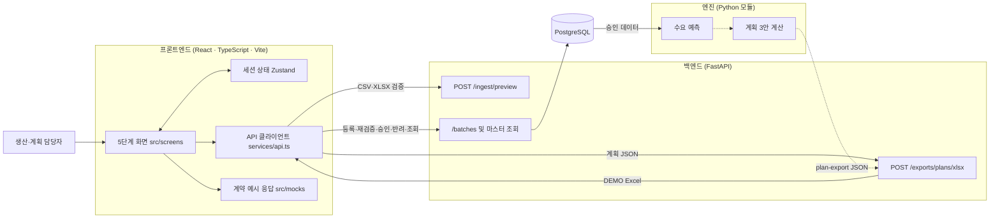

| 구성 요소 | 역할 | 현재 상태 |
|---|---|---|
| 프론트엔드 | 업로드 검토, 예측 확인, 계획 비교, 진단, 승인·출력 | 구현 |
| `POST /ingest/preview` | 저장 없는 파일 파싱·매핑·검증 | 서버 동작 |
| `POST /exports/plans/xlsx` | 계획 JSON을 DEMO/UNVERIFIED Excel로 출력 | 서버 동작 |
| `/batches*`, 마스터 조회 | 배치 저장·승인, 승인 데이터 조회 | 실제 PostgreSQL API 연결 |
| 예측 모듈 | P50·P80·P90 수요 예측 | 승인 수요 실행·저장·이력 API 및 실제 화면 연결 |
| 계획 모듈 | 기준형·안정형·비용절감형 계산 | 구현 전, 예시 응답 사용 |
| 로그인·권한, 계획 승인 저장 | 사용자 인증, 승인 이력 영구 저장 | 없음 |

---

## 워크플로

### 전체 업무 흐름

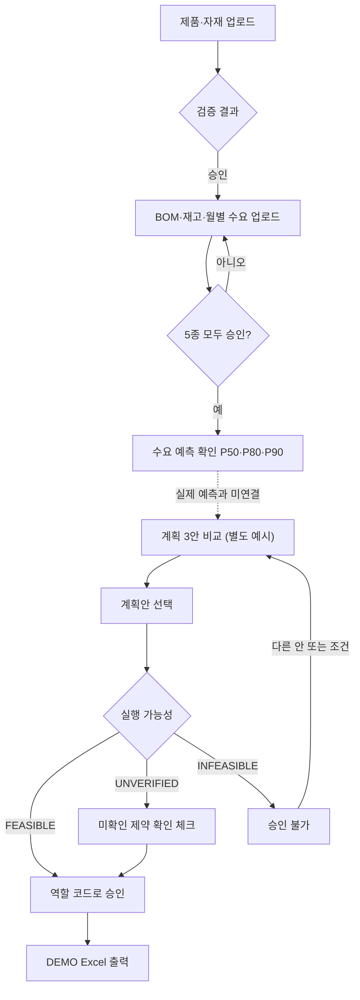

### 데이터 배치 상태

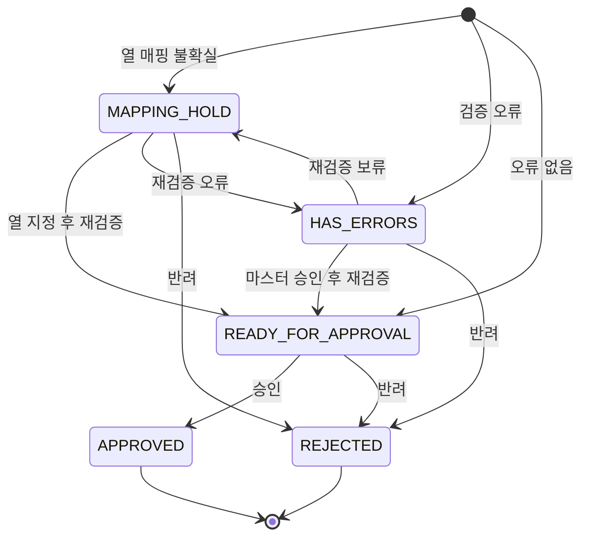

---

## 데이터와 API 시각화

### 데이터 승인 순서

참조되는 쪽을 먼저 승인합니다.

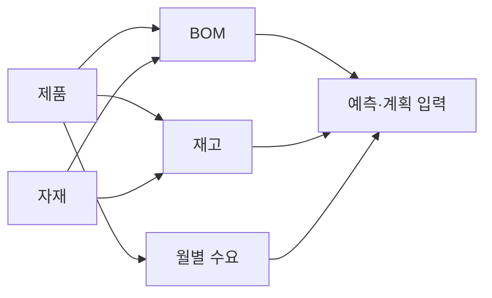

### API 호출 순서

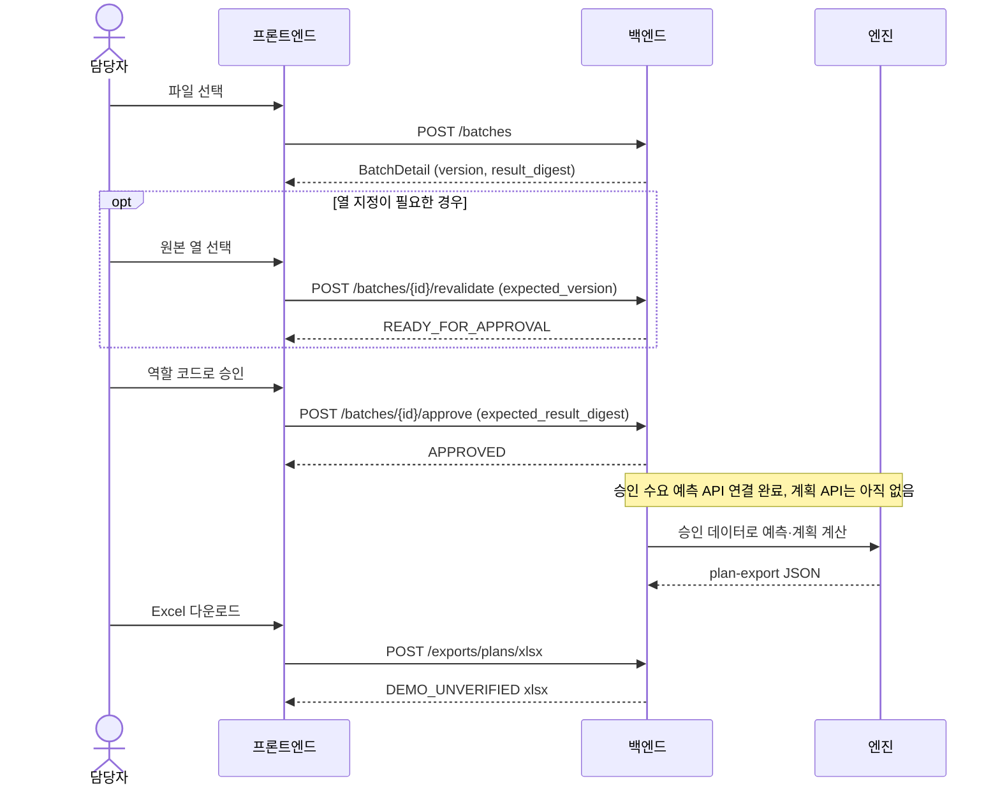

### API 맵

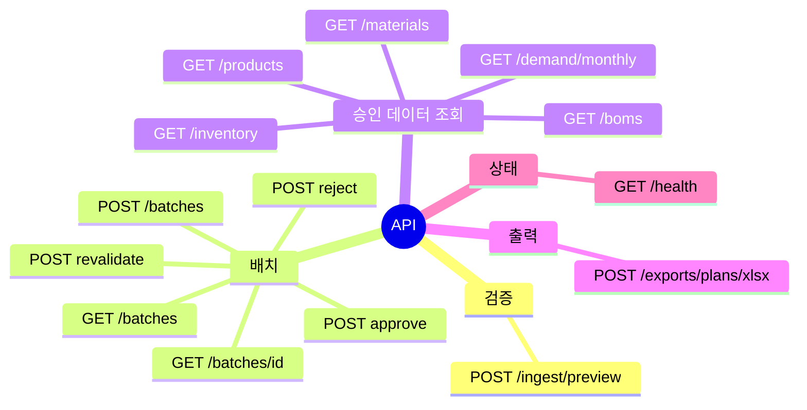

---

## 계획안 예시 결과

아래 수치는 모두 `src/mocks`의 **합성 예시 데이터**이며 실제 기업 데이터가 아닙니다.

### 수요 분위수 (3개월)

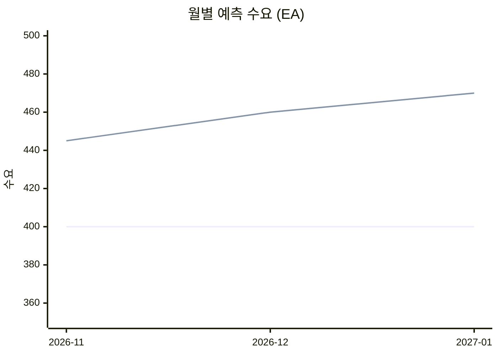

아래쪽 선이 P50, 위쪽 선이 P80입니다.

### 총비용 비교

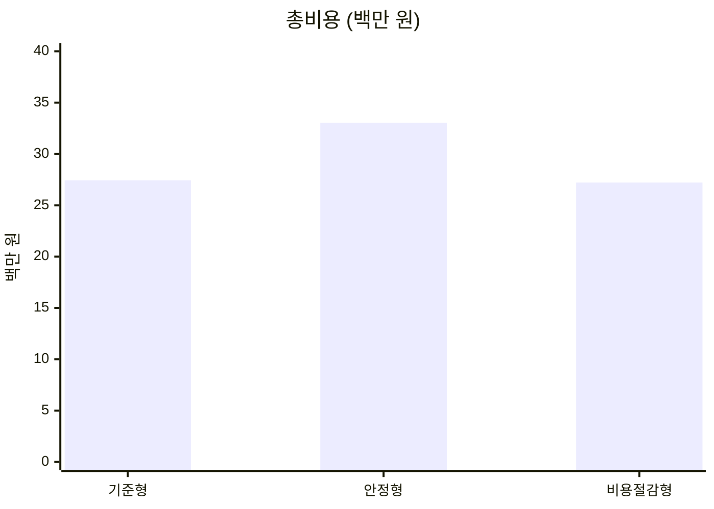

### 잔업 시간 비교

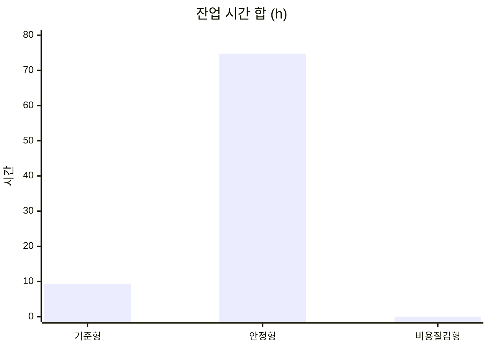

### P80 수요 충족률

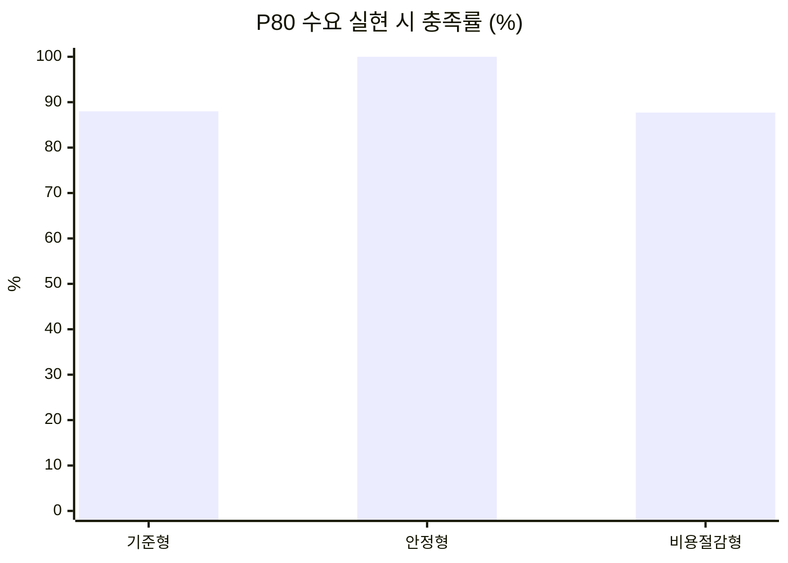

### 기준형 비용 구성

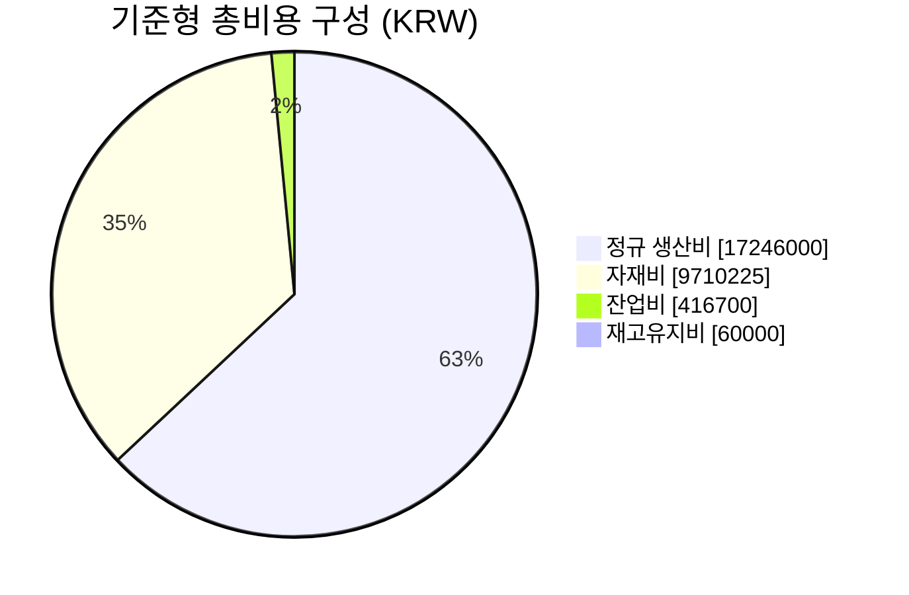

### 조건별 실행 가능성

| 조건 | 기준형 | 안정형 | 비용절감형 |
|---|:---:|:---:|:---:|
| 기본 | 🟢 실행 가능 | 🟡 확인 필요 | 🟢 실행 가능 |
| 수요 +20% | 🟡 확인 필요 | 🔴 실행 불가 | 🔴 실행 불가 |

---

## 프로젝트 구조

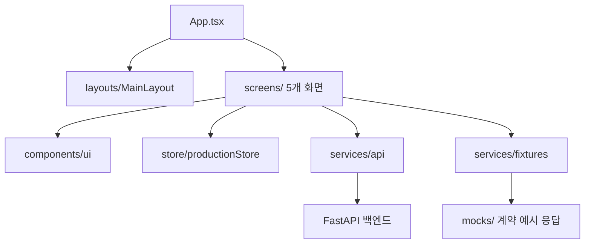

---

## 🛠 기술 스택

- **Frontend**: React 18 + TypeScript
- **Build Tool**: Vite
- **State Management**: Zustand
- **Styling**: 단일 CSS (`src/styles/app.css`)
- **UI/UX**: 현장 사진 배너와 단계 탭, 밝은 작업면의 표 중심 업무 화면

### 색상 및 디자인
- **헤더**: 생산 현장 사진 배너와 겹치는 단계 탭
- **배경**: 밝은 회청색 (#f5f7f9)
- **강조**: 파란색 (#0a6ed1)
- **텍스트**: 진한 회색/검은색 (가독성 최적화)

---

## 📦 설치 및 실행

### 필수 조건
- Node.js 20 이상 (브라우저 E2E 포함)
- npm 또는 yarn

### 설치
```bash
git clone https://github.com/ChungPaMo/decision-supporter-frontend.git
cd decision-supporter-frontend
npm install
```

### 개발 서버 실행
```bash
npm run dev
```
브라우저에서 `http://127.0.0.1:5173` 접속. Vite는 이 주소에만 바인딩하며 포트 충돌 시 종료합니다.

백엔드 저장소의 Git 제외 `.env`에 `PERSISTENCE=postgres`, `CORS_ALLOW_ORIGINS=http://127.0.0.1:5173`를 설정하고 API를 127.0.0.1:8000에서 시작합니다. 프론트 `.env.local`에는 `VITE_API_URL=http://127.0.0.1:8000`을 둡니다. DB 비밀번호는 프론트에 넣지 않습니다.

### 검증

```powershell
npm run type-check
npm run build
node node_modules/@playwright/test/cli.js install chromium
npm run test:e2e
```

E2E는 sibling `decision-supporter/.venv`를 사용하고 **chungpamo_test의 public 스키마만 초기화**합니다. 실행 중인 충파모 Docker 자원과 고정 loopback 주소·포트·역할을 검사하며, 개발 DB에는 쓰지 않습니다. 테스트 API는 8001, 프론트는 5174를 사용하고 테스트 후 종료합니다. 실제 등록·승인·조회·409 충돌·새로고침·API 프로세스 재시작을 검증합니다. 422/501/503/네트워크 오류 표시 시험에서는 해당 오류 응답만 주입합니다.

### 빌드
```bash
npm run build
```

---

## 📝 라이선스

이 프로젝트는 ChungPaMo에서 관리합니다.

---

## 👥 개발자

**UI/UX 개발**: Claude Code
**설계 및 컨설팅**: ChungPaMo Team

---

## 📞 지원

문제가 발생하거나 기능을 요청하려면 GitHub Issues를 통해 연락해주세요.

---

**Made with ❤️ for Manufacturing Excellence**
