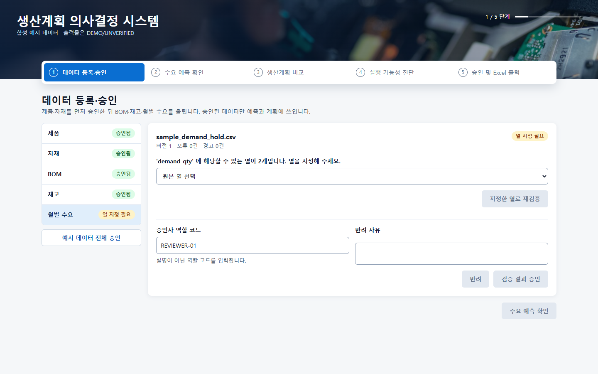
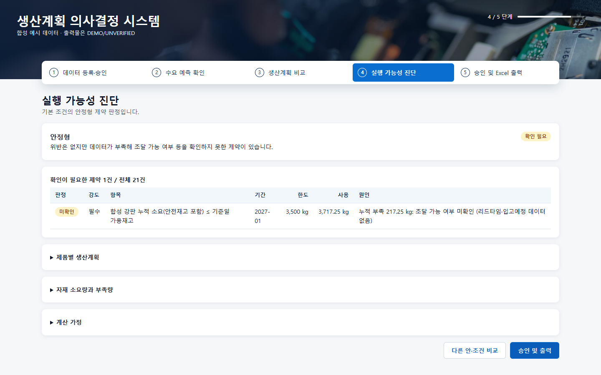
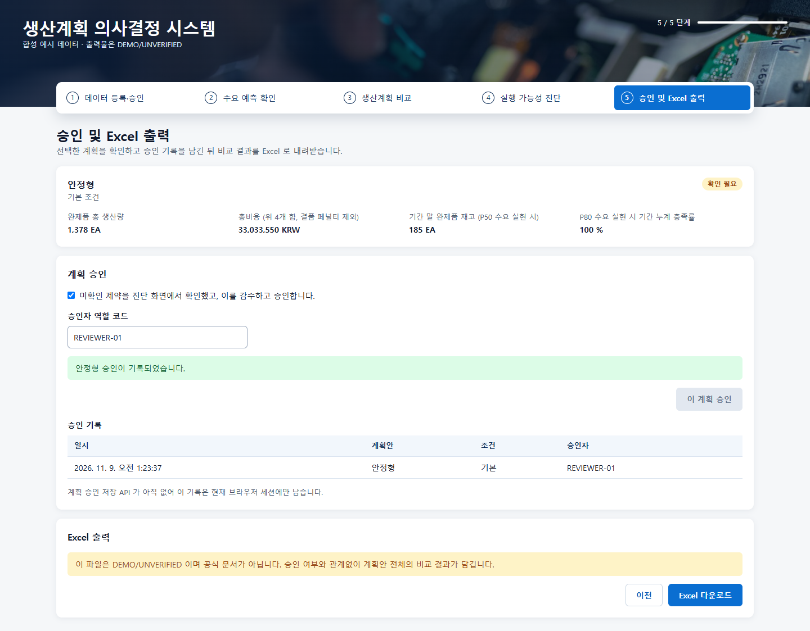

# 생산계획 의사결정 시스템 (Production Planning Decision Support System)

제조 중소·중견 기업의 수요 예측, 생산계획 비교, 실행 가능성 진단, 최종 승인까지의 전체 의사결정 프로세스를 지원하는 AI 기반 웹 애플리케이션입니다.

## 핵심 흐름

`decision-supporter/docs`의 API·엔진 계약 순서를 따릅니다: 데이터 승인 → 수요 예측 → 계획 3안 비교 → 제약 진단 → 승인·Excel 출력.

### 1. 데이터 등록·승인



- 제품·자재를 먼저 승인해야 BOM·재고·월별 수요를 올릴 수 있습니다.
- 배치 상태(`MAPPING_HOLD`, `HAS_ERRORS`, `READY_FOR_APPROVAL`, `APPROVED`, `REJECTED`)별로 열 지정·재검증, 오류 확인, 승인·반려를 처리합니다.
- 승인자는 실명이 아닌 역할 코드(`REVIEWER-01`)로 입력합니다.
- 내 파일 검증은 실제 `POST /ingest/preview`를 호출합니다.

### 2. 수요 예측 확인


- 제품·월별 P50·P80·P90, 실행 정보, 제외 제품, 분위수 보정, 경고를 표시합니다.

### 3. 생산계획 비교


- 기준형·안정형·비용절감형의 KPI와 실행 가능성(`FEASIBLE`, `UNVERIFIED`, `INFEASIBLE`)을 나란히 비교합니다.
- 기본 조건과 수요 +20% 조건을 전환합니다. 시스템은 순위를 매기지 않습니다.

### 4. 실행 가능성 진단



- 선택한 계획의 위반·미확인 제약과 원인, 제품별 생산계획, 자재 소요·부족량, 계산 가정을 보여줍니다.

### 5. 승인 및 Excel 출력



- 실행 불가 계획은 승인할 수 없고, 미확인 계획은 확인 체크 후 승인합니다.
- Excel은 실제 `POST /exports/plans/xlsx`를 호출하며 DEMO/UNVERIFIED 출력입니다.

### API 연결 현황

| 영역 | 현재 동작 |
|---|---|
| `POST /ingest/preview`, `POST /exports/plans/xlsx` | 실제 서버 호출 (서버 `.env`에 `CORS_ALLOW_ORIGINS=http://localhost:5173` 필요) |
| `/batches*`, 마스터 조회 | 서버 기본 설정이 501이라 `src/mocks`의 계약 예시 응답으로 동작 |
| 예측·계획 생성, 계획 승인 저장 | API 미구현. 예시 응답과 브라우저 세션 기록으로 동작 |

---

## 🛠 기술 스택

- **Frontend**: React 18 + TypeScript
- **Build Tool**: Vite
- **State Management**: Zustand
- **Styling**: 단일 CSS (`src/styles/app.css`)
- **UI/UX**: 현장 사진 배너와 단계 탭, 밝은 작업면의 표 중심 업무 화면

### 색상 및 디자인
- **헤더**: 생산 현장 사진 배너와 겹치는 단계 탭
- **배경**: 밝은 회청색 (#f5f7f9)
- **강조**: 파란색 (#0a6ed1)
- **텍스트**: 진한 회색/검은색 (가독성 최적화)

---

## 📦 설치 및 실행

### 필수 조건
- Node.js 16 이상
- npm 또는 yarn

### 설치
```bash
git clone https://github.com/ChungPaMo/decision-supporter-frontend.git
cd decision-supporter-frontend
npm install
```

### 개발 서버 실행
```bash
npm run dev
```
브라우저에서 `http://localhost:5173` 접속

### 빌드
```bash
npm run build
```

---

## 📝 라이선스

이 프로젝트는 ChungPaMo에서 관리합니다.

---

## 👥 개발자

**UI/UX 개발**: Claude Code
**설계 및 컨설팅**: ChungPaMo Team

---

## 📞 지원

문제가 발생하거나 기능을 요청하려면 GitHub Issues를 통해 연락해주세요.

---

**Made with ❤️ for Manufacturing Excellence**
